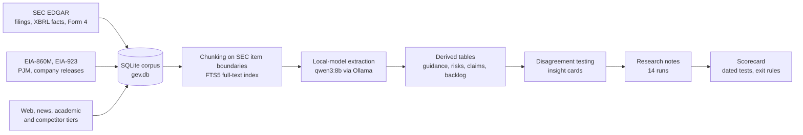

# GEV Research Corpus

[](LICENSE)
[](LICENSE)
[](requirements.txt)
[](data/README.md)

**Live site:** [gev-research.pages.dev](https://gev-research.pages.dev), the filings-only financials page built from this corpus, with the research sections and the decision.

A reproducible research corpus and analysis pipeline built around one question: **is GE Vernova (NYSE: GEV) mispriced over a three-to-twelve-month horizon?**

It was built in two weeks, 19 September to 2 October 2026, for an intercollegiate stock pitch competition whose universe was eight US-listed names (ABNB, ADBE, CPRT, GEV, NCLH, NKE, SBUX, SPOT). The pitch itself, a two-page memo and an Excel model, is not published. Everything that fed it is: the pipeline, the database it produced, fourteen runs of research notes, and a scorecard on which the call is graded in public as each test date passes.

Nothing in this repository is investment advice.

## Contents

- [How it works](#how-it-works)
- [Repository layout](#repository-layout)
- [Quick start](#quick-start)
- [The database](#the-database)
- [What the research found](#what-the-research-found)
- [The call and its scorecard](#the-call-and-its-scorecard)
- [Rebuilding from scratch](#rebuilding-from-scratch)
- [Verification](#verification)
- [Sources and licensing](#sources-and-licensing)

## How it works



Every stage writes to one SQLite file and is resumable. Extraction runs on a local GPU with no external service, so a full overnight pass costs nothing to repeat. Every extracted value keeps the verbatim quote it came from, which is what the validation sample checks.

## Repository layout

```
.
├── src/                      pipeline: ingestion, indexing, extraction, derivation, pages
├── scripts/
│   ├── build_public_db.py    how the public database was built from the private one
│   └── thesis_pdf/           typesetting for the thesis file
├── config/                   ticker universe, research angles, customer list, config.example.json
├── docs/
│   ├── GEV_SCORECARD.md      the call, its dated tests, exit rules and running log
│   ├── research/multi_agent/ the research notes, fourteen runs (README.md is the index)
│   ├── financials/           filings-only financials page and the CSVs behind it
│   └── PITCH_READING_LIST.md memo format and the examples the write-up followed
├── research/                 single-question research job (deposit terms, upgrade bridge)
├── debate/                   long/short debate harness and its round summary
├── data/
│   ├── README.md             data sheet for the public database (tables, counts, exclusions)
│   └── validation_sample.csv 450 sampled extractions with the quote-verbatim check
└── *.cmd                     Windows helpers for the overnight runs
```

## Quick start

Read first: [`docs/GEV_SCORECARD.md`](docs/GEV_SCORECARD.md) for the call, [`docs/research/multi_agent/README.md`](docs/research/multi_agent/README.md) for the index of research runs, and [`docs/research/multi_agent/12_team_brief/TEAM_BRIEF.md`](docs/research/multi_agent/12_team_brief/TEAM_BRIEF.md) for the numbers behind the thesis with their sources. The thesis dossier, [`GEV_THESIS_DOSSIER.html`](docs/research/multi_agent/13_thesis_dossier/GEV_THESIS_DOSSIER.html), is a self-contained HTML file with eleven charts; download it and open it in a browser.

To query the data, download the public database (see below) and run:

```bash
pip install datasette
datasette data/gev_public.db --setting sql_time_limit_ms 10000
```

Datasette gives every table a page, every row a URL and every query a SQL box. A query to start with, full-text search over 426 thousand filing passages:

```sql
SELECT ticker, form, filing_date, section,
       snippet(chunks_fts, 0, '[', ']', '...', 24) AS passage
FROM chunks_fts
WHERE chunks_fts MATCH '"slot reservation" AND gigawatts'
LIMIT 20;
```

## The database

The public build, `gev_public.db`, is a single SQLite file of about 2.1 GB, distributed separately from this repository. [`data/README.md`](data/README.md) gives the download location, every table with its row count, and what was removed.

| Layer | Content |
|---|---|
| Filings | 9,715 SEC filings in full text for 18 companies: 10-K, 10-Q, 8-K, proxies, registration statements |
| Passages | 426,164 chunks cut on SEC item boundaries, with an FTS5 index |
| Structured facts | 339,610 XBRL facts, 7,603 insider transactions, 1.6 million EIA generator-month rows |
| Derived by the pipeline | 4,005 guidance statements, 1,087 guidance-history rows, 3,982 claims, 6,311 raw extractions, 385 risk items, 16 insight cards, analyst statements, competitor segment figures, backlog metrics by quarter |

Not in the public build, and why: daily prices (vendor terms; `src/ingest_market.py` re-downloads them), embeddings (regenerable with `src/embed.py`), Bloomberg-sourced rows (licensed), LinkedIn-sourced rows (personal data), and the stored text of third-party web pages, news items and academic abstracts (copyright; URL, title and date remain).

## What the research found

- **No provable mispricing on a name with forty-odd analysts.** Three multi-agent sweeps and an overnight run of 49 single-model tasks killed nine bear arguments and found no number where the Street was demonstrably wrong. The method removes false edges; it does not create one.
- **The thesis that survived is a gigawatt view.** Power-equipment revenue is output times price per kilowatt. The signed backlog prices at about $741/kW against the $579/kW (2027) and $662/kW (2028) that consensus revenue implies; signed demand of 116 GW (53 GW firm plus 63 GW of paid reservations) exceeds the 111 GW of planned output to 2030. Price and demand are contracted; factory output is the open variable.
- **The constraint is physical.** Single-crystal hot-section castings from four Western foundries pace the ramp. Shipments ran 14.6 GW in the last four quarters against a plan of 20 GW a year from the second half of 2026.
- **The one dated variant view** is the late-January 2027 outlook: consensus needs the largest one-year margin step since the spin, and the notes put the odds of a first guide below the Street at roughly two in three.

Each of these is worked through with sources in the team brief and the dossier.

## The call and its scorecard

Long GE Vernova at $987.45, the close of 1 October 2026, for twelve months to 30 September 2027. Base target $1,126 at 25x forward EBITDA, bear case $855 at 21x, break-even exit multiple 21.8x.

| Date | Test | Supports | Warns or kills |
|---|---|---|---|
| 28 Oct 2026 | Gas turbine GW shipped in Q3 | about 5 GW or more | 4.2 GW or less, twice after the plan date, is an exit |
| 28 Oct 2026 | Services revenue vs consensus $4,486M | at or above | about $4,300M or less supports the short-side hedge |
| Late Jan 2027 | FY2027 adjusted EBITDA guide, midpoint | about $9.0B or more | about $7.7B or less is an exit |
| Spring 2027 | 2030 outlook at the investor day | 30 GW output plan held | a cut to the 20% 2028 margin target is an exit |

The entry did not advance in the competition. The scorecard is graded regardless, and the result column is filled in on each date whichever way it goes.

## Rebuilding from scratch

1. `pip install -r requirements.txt`, and install [Ollama](https://ollama.com) with the `qwen3:8b` and `nomic-embed-text` models.
2. Copy `config/config.example.json` to `config/config.json` and put a real contact in `sec_user_agent`; EDGAR refuses requests without one.
3. `python src/run_all.py` runs the EDGAR stages in order and is safe to re-run: filing index, full text, XBRL facts, prices, insider transactions, chunking and the full-text index.
4. `python src/ingest_tabular.py` for EIA-860M and EIA-923; `python src/ingest_web.py` and `python src/ingest_primary.py` for the web, academic, competitor and operator tiers.
5. `python src/extract.py`, `python src/embed.py`, `python src/derive.py`, `python src/thesis.py` for the derived layers, or `python src/overnight.py` for the unattended version (`night2.cmd` starts it, `morning.cmd` reports on it).

A full rebuild takes a night and roughly seven gigabytes of disk, most of it raw downloads.

## Verification

- **Extraction quality.** `data/validation_sample.csv` holds 450 sampled extractions; 426 of them, 94.7%, quote their source verbatim. The three human-review columns were not completed.
- **The numbers in the notes** were checked three ways: 79 checks against filing text and filed data, and 131 against licensed data and by recalculation. Section 10 of the team brief describes the method.
- **The call itself** is checked by the scorecard on dates fixed before any of them arrived.

## Sources and licensing

| Source | Status in this repository |
|---|---|
| SEC EDGAR filings and the XBRL company-facts API | Public domain; included in full |
| EIA-860M and EIA-923 | Public; included |
| PJM results, company releases and calls, trade press, academic abstracts | Cited by URL; text not redistributed beyond short quotes |
| Bloomberg | Licensed for academic use; single figures appear with their date, no series are reproduced, and one chart was removed from the public dossier |

Code is released under the [MIT License](LICENSE). The research notes, the derived tables and the scorecard are released under [CC BY 4.0](https://creativecommons.org/licenses/by/4.0/).

The research notes were produced by language-model agents working over this corpus, the filings and the open web, then checked by hand against sources; every number carries one. They are research input, not the pitch.
